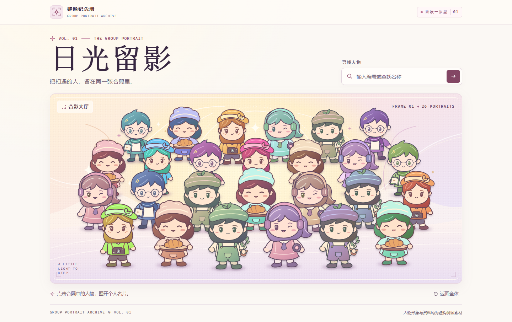

# 群像纪念册 · 日光留影

这是阶段一的 26 人排布测试。桌面四排，从后往前各 6、7、7、6 人。手机五排，从后往前各 5、5、6、5、5 人。合影只展示人物形象。点击人物可以打开个人资料，也可以输入编号或查找名称，从搜索结果定位人物。打开个人资料后，其余人物会变暗，点舞台空白处、关闭资料或按 Esc 可以取消选择。清空搜索和「返回全体」会一并恢复整张合照。



协作者从 [协作指南](CONTRIBUTING.md) 开始。Agent 先读 [AGENTS.md](AGENTS.md)，再用 [项目结构与修改指南](docs/项目结构与修改指南.md) 查功能入口、可改项和预期效果。

## 本地运行

基线标签为 `v0.1.0`。首次下载后，在项目目录使用 [.node-version](.node-version) 中的 Node.js 24.16.0，并用 `npm ci` 按 [依赖锁文件](package-lock.json) 安装。页面与图片都来自仓库。

```bash
git clone https://github.com/fushuyiliu/group-portrait-archive.git
cd group-portrait-archive
git switch --detach v0.1.0
npm ci --cache .npm-cache
npm run dev -- --port 3218
```

以上用于复现指定基线。准备贡献时，按 [协作指南](CONTRIBUTING.md) 从最新 `main` 开任务分支。Windows PowerShell 若限制 npm 脚本执行，可把命令中的 `npm` 替换成 `npm.cmd`。

浏览器打开 [本地预览](http://127.0.0.1:3218/)，按 Ctrl+C 可停止预览。桌面用 1440 × 900，手机用 390 × 844，等人物加载后与 [基线截图](#自测与截图) 对照。页面使用系统字体，系统差异会影响文字字形。

## 浏览器测试

在项目目录运行以下命令。测试会在端口 3219 临时启动生产构建，逐个点选 26 位人物并验证编号和名称搜索。

```bash
npm run typecheck
npm run build
npx playwright install chromium
npm run test:browser
```

Linux 若缺少 Chromium 系统依赖，可使用 `npx playwright install --with-deps chromium`。如需把浏览器下载留在项目目录，在安装和测试前将 `PLAYWRIGHT_BROWSERS_PATH` 设为 `0`。PowerShell 可用 `$env:PLAYWRIGHT_BROWSERS_PATH = '0'`，Bash 可用 `export PLAYWRIGHT_BROWSERS_PATH=0`。

## 人物和素材

| 路径 | 用途 |
| --- | --- |
| `data/members.ts` | 26 位测试人物的编号、查找名称、图片地址和可选资料 |
| `data/portrait-layout.ts` | 桌面与手机各排的槽位顺序、横向范围、基线和缩放 |
| `public/assets/members/` | 26 张独立透明 SVG，使用五种原创轮廓和测试配色 |
| `public/assets/backgrounds/` | 大厅使用的原创背景 |
| `components/portrait-hall.tsx` | 合影、搜索和资料名片 |
| `app/globals.css` | 桌面侧栏、移动底部面板、层级和动效 |

两个布局按行生成 `position` 和 `mobilePosition`。坐标用舞台宽高的百分比表示，锚定在人物图像底部，`scale` 决定大小，`layer` 决定初始图层。交互通过稳定的 `memberId` 关联。001 至 005 用于验证完整资料，006 至 026 用于验证只有编号、名称和图片的情况。

## 自测与截图

自测记录见 [阶段一自测](docs/阶段一自测.md)。以下为本地浏览器实际截图。

- [桌面合影](docs/screenshots/desktop.png)
- [桌面名片](docs/screenshots/desktop-profile.png)
- [手机合影](docs/screenshots/mobile.png)
- [手机名片](docs/screenshots/mobile-profile.png)

## 正式形象图接入前

1. **收图和入库。** 上传时必填透明 PNG、编号和查找名称。编号按统一规则查重，名称同名时用编号区分。保存原图和展示图，并用稳定的 `memberId` 关联；个人简介等现有测试字段在正式接入时可设为可选。成员自行提交时，需明确谁可提交、换图和发布。
2. **统一图像尺度。** 按透明边界裁掉多余留白，统一脚底锚点，保留原比例和朝向。验证图像可解码，并生成适合大厅加载的展示版本。
3. **用实际素材校准。** 先用少量获授权的 PNG 复核站位、遮挡和点击区域，再按实际人数调整两套排布。替换图片后检查搜索定位、首次加载和编号对应关系，并用手机真机验收。
